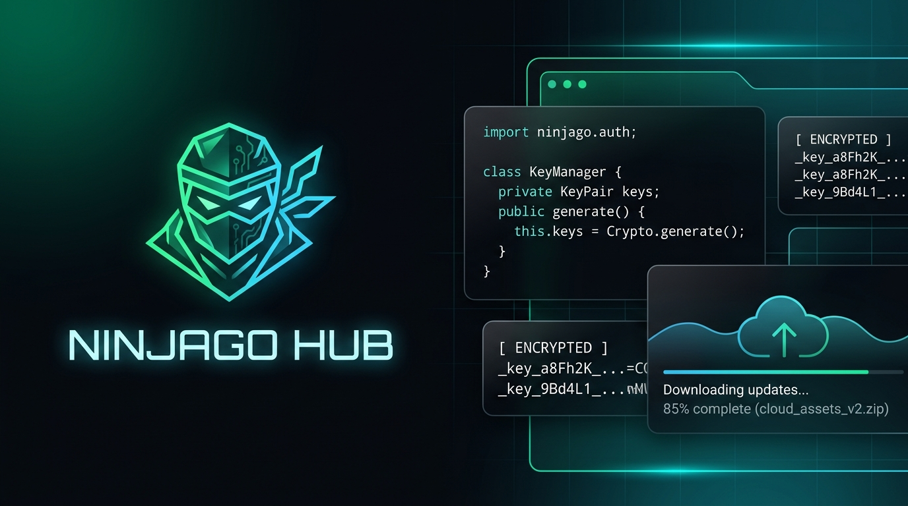

  

<h1 align="center">Ninjago Hub</h1>

  Современное Android-приложение на Kotlin и Jetpack Compose для публикации, поиска и скачивания скриптов, сборок, конфигов и эксклюзивных файлов с облачной синхронизацией в реальном времени.

  
  
  

---

## Возможности приложения

### Для пользователей (без регистрации и входа)
- **Стартовый экран (однократный):** знакомит с эксклюзивным контентом и содержит интерактивные карточки с переходом в Telegram-каналы сообщества — [**@NinjagoScript**](https://t.me/NinjagoScript) и [**@EstaxCheats**](https://t.me/EstaxCheats).
- **Живая лента публикаций:** автоматическое обновление списка постов и файлов из облака в реальном времени.
- **Поиск и фильтрация:** мгновенный поиск по названию, описанию, тегам и имени файла, а также фильтры по категориям и типу доступа (*Открытые* / *По ключу*).
- **Загрузка и управление файлами:** встроенный загрузчик с отображением прогресса, сохранением в `Downloads/NinjagoHub` и быстрыми кнопками *Открыть* и *Поделиться*.
- **Уведомления о новых публикациях:** системные Android-уведомления и встроенная лента непрочитанных постов.
- **Доступ по ключам:** активация VIP/эксклюзивных публикаций с проверкой лимита использований и срока действия на сервере в реальном времени.

### Для администраторов
- **Скрытый вход:** окно авторизации открывается после **6 нажатий** на пункт *«Версия сборки»* в разделе *Настройки*.
- **Публикация контента:** прикрепление файлов с устройства, вставка текстового скрипта/конфига или добавление прямой HTTPS-ссылки, настройка тегов, категорий и режима доступа (*Открытый* или *По ключу*).
- **Панель ключей (Live):** генерация кодов доступа с настраиваемым числом активаций, сроком действия (*1 час, 24 часа, 7 дней, 30 дней, бессрочно*), мгновенным включением/паузой, редактированием лимитов и журналом активаций по устройствам в реальном времени.
- **Управление командой:** создание дополнительных учётных записей администраторов и управление их активностью.

---

## Стек технологий

- **Язык и UI:** Kotlin, Jetpack Compose (Material Design 3), Edge-to-Edge UI
- **Архитектура:** MVVM (`ViewModel`, `StateFlow`), Kotlin Coroutines & Flow
- **Облако и БД:** Firebase Firestore (реактивные `snapshots()` + Firestore Security Rules)
- **Хранение настроек:** Jetpack DataStore Preferences
- **Сеть и файлы:** OkHttp, Android MediaStore Downloads API, `FileProvider`
- **CI/CD:** GitHub Actions (`.github/workflows/build-apk.yml`) — автоматическая сборка `app-debug.apk` и публикация в **GitHub Releases**

---

## Автоматическая сборка APK (GitHub Actions)

При каждом пуше в ветку `main` (или при ручном запуске через `workflow_dispatch`) рабочий процесс собирает свежий `debug` APK, сохраняет артефакт `app-debug-apk` и публикует готовый `.apk`-файл в раздел **Releases** репозитория для быстрой установки на телефон.

### Скачивание на телефон
1. Откройте вкладку **Releases** в этом репозитории на GitHub.
2. Выберите последний релиз (`Latest`).
3. Скачайте `.apk`-файл из секции **Assets** и установите на Android-устройство.
